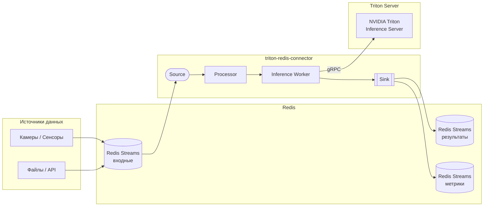

# triton-redis-connector

Микросервисный компонент для инференса ML-моделей через NVIDIA Triton Inference Server с использованием Redis Streams в качестве транспорта.

## Архитектура



## Пакеты

| Пакет | Путь | Описание |
|-------|------|----------|
| `triton-shared-models` | `packages/triton_shared_models/` | Общие типы Triton (`TritonModelConfig`, `TritonDataType`, `config.pbtxt`), letterbox-препроцессинг, NMS |
| `triton-redis-connector` | `packages/triton_redis_connector/` | Коннектор Redis Streams <-> Triton: граф-пайплайн с 9 вариантами исполнения |
| `triton-model-tools` | `packages/triton_model_tools/` | CLI для конвертации, инференса, бенчмаркинга и верификации YOLO-моделей для Triton |

Направление зависимостей:
```
triton_model_tools -> triton_redis_connector -> triton_shared_models (leaf)
```

Полная архитектура описана в [docs/architecture.md](docs/architecture.md).

## Быстрый старт

```bash
# Установка зависимостей
uv sync --dev

# Запуск инфраструктуры
docker compose up -d redis              # только Redis
docker compose up -d                    # Redis + Triton (требует GPU)

# Проверка
uv run pre-commit run --all-files
uv run pytest
```

## Разработка

| Команда | Описание |
|---------|----------|
| `uv run ruff format .` | Форматирование кода |
| `uv run ruff check .` | Линтер (ruff) |
| `uv run ruff check --fix .` | Автоисправление линтера |
| `uv run mypy .` | Проверка типов (mypy strict) |
| `uv run pyright` | Проверка типов (pyright strict) |
| `uv run lint-imports` | Проверка архитектурных контрактов импортов |
| `uv run vulture` | Поиск мертвого кода |
| `uv run pytest` | Запуск тестов (параллельно) |
| `uv run pytest -x` | Остановка на первом падении |
| `uv run pytest -k test_name` | Запуск конкретного теста |
| `uv run pre-commit run --all-files` | Все проверки по порядку |

## CLI-команды (triton-model-tools)

Все команды запускаются через `uv run triton-model-tools <command>`.

| Команда | Описание |
|---------|----------|
| `convert` | Конвертация YOLO .pt в формат Triton (ONNX/TensorRT) с опциональной верификацией |
| `infer` | Запуск YOLO-инференса на папке изображений через Triton |
| `local-infer` | Локальный инференс через ONNX Runtime (без Triton) |
| `predict` | Запуск ultralytics YOLO-предсказания и сохранение результатов в txt |
| `benchmark` | Бенчмарк инференса через Triton |
| `e2e-test` | E2E тест: загрузка изображений в Redis, обработка через Triton, сбор результатов |
| `pipeline-predict` | Отправка изображений через Redis-пайплайн, сохранение результатов детекции |
| `pipeline-benchmark` | Измерение E2E производительности Redis-пайплайна |
| `compare-folders` | Сравнение результатов детекции из двух папок (baseline vs candidate) |
| `compare-visual` | Визуальное сравнение local vs Triton через FiftyOne |
| `populate-stream` | Заполнение Redis Stream тестовыми изображениями |
| `validate` | Валидация структуры и config.pbtxt файлов модельного репозитория Triton |
| `download-coco` | Скачивание COCO val2017 для бенчмаркинга |

## Пример: dual_model_pipeline

Полный пайплайн стальной инспекции с двумя моделями и ветвлением по камерам. Демонстрирует использование shipped-процессоров (`EnvelopeExtractor`, `EventSerializer`, `LogErrorSink`).

```
examples/dual_model_pipeline/
├── config.yaml           — конфигурация (Redis, Triton, очереди)
├── run_pipeline.py       — точка входа (загрузка конфига + регистрация узлов)
├── processors.py         — доменные процессоры (роутинг, препроцессинг, инференс, постпроцессинг)
├── events.py             — модели событий с Counter/Gauge/GroupBy метриками
└── test_deterministic.py — детерминистический тест без Triton
```

Граф обработки:

```
RedisStreamSource -> EnvelopeExtractor -> CameraBranchRouter
  -> [even] DaliPreprocessor --------+
  -> [odd]  TurboJpegPreprocessor ---+-> MetadataInferenceWorker
                                         -> InspectionPostProcessor
                                             -> EventSerializer -> RedisStreamSink
                                         -> LogErrorSink (InferenceError)
```

Запуск:

```bash
# Заполнить Redis Stream тестовыми данными
uv run triton-model-tools populate-stream --image-dir ./images --stream steel:inspection_input

# Запустить пайплайн
uv run python examples/dual_model_pipeline/run_pipeline.py
```

## Инфраструктура (Docker Compose)

Инфраструктура определена в `.devcontainer/docker-compose.yml`:

| Сервис | Образ | Порт | Описание |
|--------|-------|------|----------|
| Redis | `redis:7-alpine` | 6379 | Очередь сообщений (Streams), AOF persistence |
| Triton | `nvcr.io/nvidia/tritonserver:26.02-py3` | 8000 (HTTP), 8001 (gRPC), 8002 (Metrics) | Inference Server, `--strict-model-config=true` |
| Triton SDK | `nvcr.io/nvidia/tritonserver:26.02-py3-sdk` | -- | `perf_analyzer`, `model_analyzer`, `tritonclient` |
| RedisInsight | `redis/redisinsight:latest` | 5540 | Веб-UI для Redis |

## Метрики

Все метрики отправляются в Redis Stream (по умолчанию `metrics`) в формате `MetricEvent` с полями `component_name`, `measure`, `value`. При отсутствии входных событий все метрики отправляются со значением `0`.

Интервал отправки настраивается через `metrics.stats_log_interval_s` (по умолчанию 60 с).

### Pipeline метрики

| Метрика | Компонент | Теги | Тип | Описание |
|---------|-----------|------|-----|----------|
| `stats_processed` | app_name | -- | counter | Кумулятивное число обработанных событий (дошедших до Sink) |
| `stats_in_progress` | app_name | -- | gauge | Число событий в обработке прямо сейчас |
| `stats_errors` | app_name | -- | counter | Кумулятивное число ошибок |
| `event_total_transit_ms` | app_name | -- | histogram | Время от создания Envelope до записи в Sink (мс) |
| `parallel_restart` | app_name | `node` | counter | Перезапуск параллельного потока |

### Per-node метрики

| Метрика | Компонент | Теги | Тип | Описание |
|---------|-----------|------|-----|----------|
| `node_events_total` | app_name | `node` | counter | Кумулятивное число вызовов узла |
| `node_events_interval` | app_name | `node` | gauge | Число событий за последний интервал статистики |
| `node_processing_ms` | app_name | `node` | histogram | Время обработки одного события узлом (мс) |
| `node_errors` | app_name | `node` | counter | Кумулятивное число ошибок по узлам |
| `source_read_total` | app_name | `node` | counter | Общее число попыток чтения источником |
| `source_read_empty` | app_name | `node` | counter | Попытки чтения, вернувшие None |
| `sink_write_total` | app_name | `node` | counter | Общее число записей в Sink |

### Метрики на событиях (объявляются на event-классах)

| Метрика | Тип | Объявление | Описание |
|---------|-----|------------|----------|
| `decode_success` | Counter | `_metrics_ = [Counter("decode_success")]` на `DecodedImage` | Успешные декодирования |
| `decode_failure` | Counter | `_metrics_ = [Counter("decode_failure")]` на `PreprocessingError` | Ошибки декодирования |
| `detection_done` | Counter | `_metrics_ = [Counter("detection_done")]` на `DetectionResult` | Завершённые детекции |
| `inference_time_ms` | Gauge | `Annotated[float, Gauge("inference_time_ms")]` на поле `DetectionResult` | Время инференса (мс) |

Для добавления новых метрик:
- **Counter**: `_metrics_ = [Counter("name")]` на классе события -- считает количество
- **Gauge**: `Annotated[float, Gauge("name")]` на поле события -- извлекает числовое значение
- **GroupBy**: `Annotated[str, GroupBy("name", window_s=60)]` на поле события -- группировка по значению поля

`Counter`, `Gauge`, `GroupBy` импортируются из `triton_redis_connector.protocols`.
`MetricEvent` содержит только 3 поля: `component_name`, `measure`, `value`.

### Queue метрики

| Метрика | Компонент | Теги | Тип | Описание |
|---------|-----------|------|-----|----------|
| `queue_depth` | app_name | `queue` | gauge | Текущая глубина очереди между узлами |
| `queue_drops_total` | app_name | `queue` | counter | Кумулятивное число сброшенных сообщений (backpressure) |

### Triton метрики (gRPC stats polling)

| Метрика | Компонент | Теги | Тип | Описание |
|---------|-----------|------|-----|----------|
| `inference_count` | triton | `model` | counter | Число инференсов |
| `execution_count` | triton | `model` | counter | Число выполнений |
| `success_count` | triton | `model` | counter | Число успешных инференсов |
| `success_time_ms` | triton | `model` | counter | Суммарное время успешных инференсов (мс) |
| `fail_count` | triton | `model` | counter | Число неудачных инференсов |
| `queue_time_ms` | triton | `model` | counter | Время в очереди Triton (мс) |
| `compute_infer_time_ms` | triton | `model` | counter | Время вычислений Triton (мс) |

### Annotated-based инструментация

Для параллельных узлов (multi-thread / multi-process) используйте `Annotated` с маркером `Tracked` для автоматического сбора метрик через `MetricAggregator`:

```python
from typing import Annotated
from triton_redis_connector.engine.metric_aggregator import Tracked

InferenceType = Annotated[InferenceWorker, Tracked("inference")]
```

`MetricAggregator` автоматически собирает `node_events_total`, `node_events_interval`, `node_processing_ms`, `node_errors`, `source_read_empty` для каждого помеченного узла.
