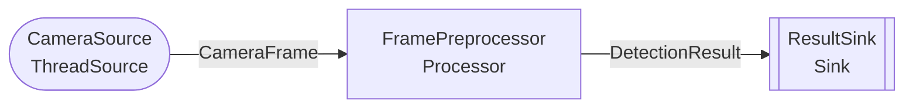

# Пример: Camera Inference (демо)

Минимальный пайплайн с синтетическими данными -- без реального инференса и без подключения к Redis/Triton. Демонстрирует автоматическую маршрутизацию событий по типовым аннотациям `__call__`.

## Структура

```
config.yaml      -- конфигурация (Hydra + переменные окружения)
events.py        -- Pydantic-модели событий: CameraFrame, DetectionResult
processors.py    -- Source, Processor, Sink (синтетические данные)
run_pipeline.py  -- точка входа
```

## Граф пайплайна



- **CameraSource** (`ThreadSource`) -- генерирует фейковые кадры `CameraFrame` с заданным интервалом
- **FramePreprocessor** (`Processor`) -- создает синтетические детекции без реального инференса
- **ResultSink** (`Sink`) -- логирует результаты через loguru

## Запуск

```bash
uv run python examples/camera_inference/run_pipeline.py
```

Ctrl+C для остановки.

## Конфигурация

Настройки в `config.yaml` загружаются через Hydra с Pydantic-валидацией (`AppConfig`). Переопределение через переменные окружения:

```bash
REDIS_HOST=localhost REDIS_PORT=6379 uv run python examples/camera_inference/run_pipeline.py
```

## Как адаптировать под свой пайплайн

1. Определите Pydantic-модели событий в `events.py`
2. Реализуйте Source/Processor/Sink в `processors.py` с правильными типовыми аннотациями `__call__`
3. Зарегистрируйте узлы в `PipelineRegistry` -- граф построится автоматически
4. Настройте `config.yaml` под свои параметры
