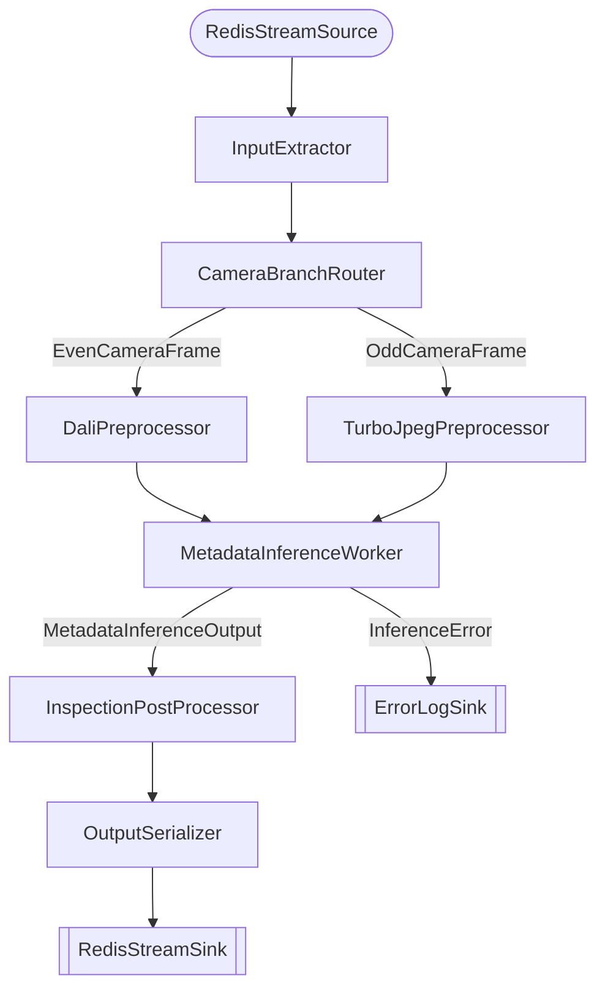

# Phase 4: Pipeline Graph & Event Flow

## Pipeline Architecture



## Event Flow

### Input (Redis Stream)
```
XADD steel:inspection_input * \
  camera_no 2 \
  image_path /data/images/frame001.jpg \
  frame_counter 1 \
  receipt_ts 1711929600.0 \
  data <empty>
```

### Branch Decision
- `camera_no % 2 == 0` → Even path (DALI + yolo11s_960x608, metal_type="HK")
- `camera_no % 2 != 0` → Odd path (TurboJPEG + yolo26l, metal_type="GK")

### Preprocessing Paths
| Path | Decoder | Preprocessing | Model | Input | Output |
|------|---------|--------------|-------|-------|--------|
| Even | DALI (server-side) | Triton DALI ensemble | yolo11s_960x608 | UINT8 raw bytes | [1,84,11970] FP32 |
| Odd  | TurboJPEG (client) | LetterBox 640x640 | yolo26l | [1,3,640,640] FP32 | [1,300,6] FP32 |

### Postprocessing
- **yolo11s_960x608** (standard): transpose → confidence filter → NMS → xyxy detections
- **yolo26l** (end-to-end): output already has [x1,y1,x2,y2,conf,class_id] → confidence filter only

### Output (Redis Stream)
```json
{
  "camera_no": 2,
  "metal_type": "HK",
  "detections_json": "[{\"x1\": 10.5, \"y1\": 20.3, ...}]",
  "model_name": "yolo11s_960x608_dali_ensemble",
  "inference_time_ms": 12.5,
  "num_detections": 3,
  "frame_counter": 1
}
```

## Metrics Emitted

| Metric | Type | Source |
|--------|------|--------|
| `inspection_received` | Counter | SteelInspectionInput |
| `even_camera_frame` | Counter | EvenCameraFrame |
| `odd_camera_frame` | Counter | OddCameraFrame |
| `camera_no_per_minute:{camera_no}` | GroupBy | EvenCameraFrame/OddCameraFrame |
| `metal_type_per_minute:{HK\|GK}` | GroupBy | MetadataInferenceInput |
| `inspection_complete` | Counter | InspectionResult |
| `inspection_inference_ms` | Gauge | InspectionResult |
| `node_processing_ms` | Per-call | All wrapped nodes |

## Files Created

| File | Lines | Purpose |
|------|-------|---------|
| `events.py` | 93 | 7 event types with Counter/Gauge/GroupBy |
| `processors.py` | ~370 | 8 processors + NMS utilities |
| `run_pipeline.py` | 121 | Pipeline assembly with signal handling |
| `config.yaml` | 38 | Hydra config |
