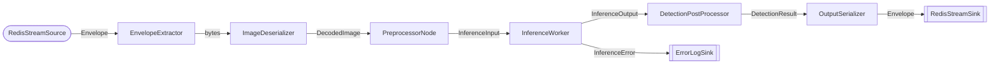

# Пример: YOLO Detection Pipeline

Полный пайплайн детекции объектов: чтение изображений из Redis Stream, препроцессинг, инференс через Triton, постпроцессинг YOLO, запись результатов обратно в Redis.

## Граф пайплайна



## Требования

- Redis запущен и доступен
- NVIDIA Triton Inference Server запущен с загруженной YOLO-моделью
- Модель экспортирована в `model_repository/` (см. `triton-model-tools export`)

```bash
# Запуск инфраструктуры
docker compose up -d
```

## Запуск

### 1. Загрузка изображений в Redis Stream

```bash
# Batch: загрузить все изображения из папки
uv run python examples/yolo_detection_pipeline/stream_images.py \
  --image-dir benchmarks/data/coco8/images/val

# Batch: загрузить 5 изображений, повторить 3 раза
uv run python examples/yolo_detection_pipeline/stream_images.py \
  --max-images 5 --repeat 3

# Streaming: непрерывная отправка с 10 FPS
uv run python examples/yolo_detection_pipeline/stream_images.py --fps 10
```

### 2. Запуск пайплайна

```bash
uv run python examples/yolo_detection_pipeline/run_pipeline.py
```

Ctrl+C для остановки.

## Конфигурация

Файл `config.yaml` загружается через Hydra с Pydantic-валидацией. Ключевые параметры:

| Секция | Параметр | Описание |
|--------|----------|----------|
| `redis` | `host`, `port` | Подключение к Redis |
| `sources[0]` | `stream_name` | Входной Redis Stream (по умолчанию `test:input_images`) |
| `sinks[0]` | `stream_name` | Выходной Redis Stream (по умолчанию `test:detection_results`) |
| `inference` | `grpc_url` | Адрес Triton gRPC (по умолчанию `triton:8001`) |
| `inference` | `num_inference_workers` | Количество воркеров инференса |
| `preprocessing` | `decoder` | Декодер изображений (`opencv` / `turbojpeg`) |
| `queues` | `maxsize` | Максимальный размер внутренних очередей |

Переопределение через переменные окружения:

```bash
REDIS_HOST=localhost TRITON_GRPC_URL=localhost:8001 INPUT_STREAM=my:input \
  uv run python examples/yolo_detection_pipeline/run_pipeline.py
```

## Компоненты пайплайна

Все процессоры определены в `processors.py`:

| Компонент | Вариант | Описание |
|-----------|---------|----------|
| `RedisStreamSource` | ThreadSource | Читает Envelope[bytes] из Redis Stream |
| `EnvelopeExtractor` | ThreadProcessor | Извлекает raw bytes из Envelope |
| `ImageDeserializer` | ThreadProcessor | Декодирует байты в DecodedImage (OpenCV) |
| `PreprocessorNode` | ThreadProcessor | Letterbox-препроцессинг в InferenceInput |
| `InferenceWorker` | ThreadProcessor | Отправляет запросы в Triton gRPC |
| `DetectionPostProcessor` | ThreadProcessor | YOLO-постпроцессинг: NMS, confidence filtering |
| `OutputSerializer` | ThreadProcessor | Сериализует DetectionResult в Envelope[bytes] |
| `ErrorLogSink` | ThreadSink | Логирует ошибки инференса |
| `RedisStreamSink` | ThreadSink | Записывает Envelope[bytes] в выходной Redis Stream |
