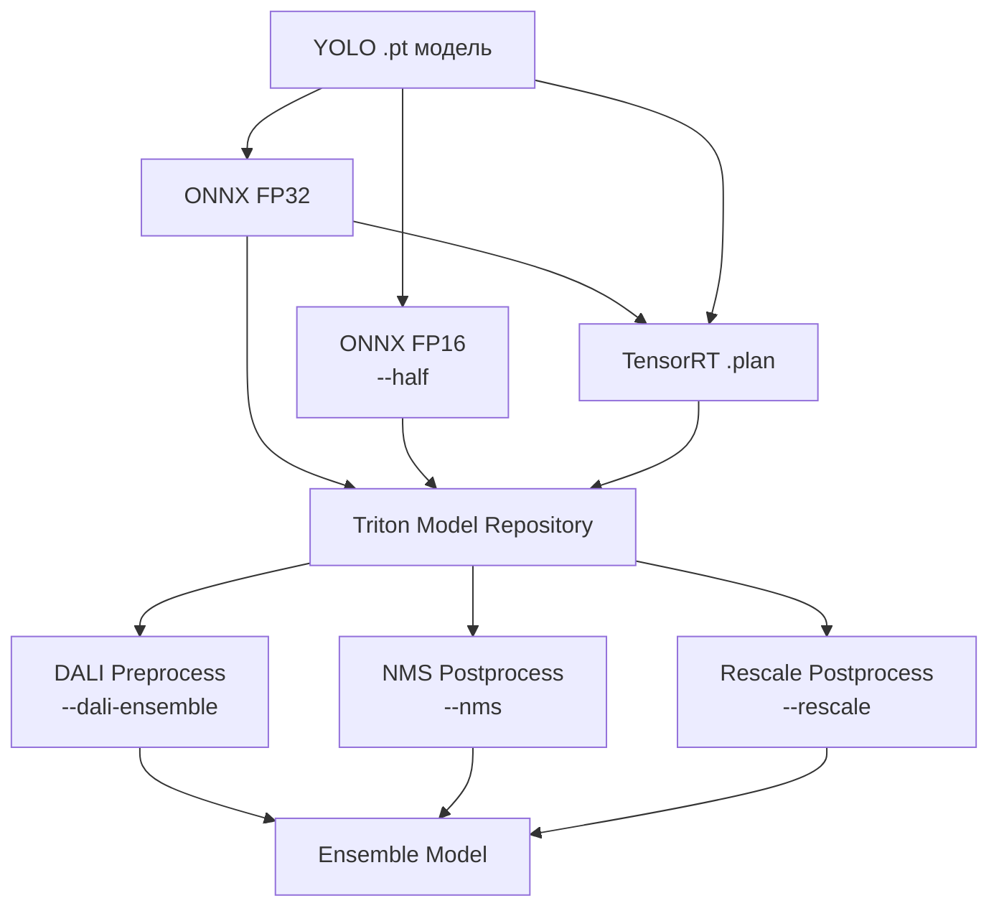

# triton-model-tools

CLI-инструменты для конвертации, инференса, бенчмаркинга и верификации YOLO-моделей на NVIDIA Triton Inference Server.

## Установка

```bash
uv sync --dev
```

## CLI-команды

Запуск через `uv run python -m triton_model_tools <command>`:

| Команда | Описание |
|---------|----------|
| `export` | Экспорт YOLO-моделей в ONNX/TensorRT для Triton |
| `infer` | Инференс изображений через Triton gRPC |
| `predict` | Локальный инференс через ultralytics (без Triton) |
| `benchmark` | Бенчмарк одной модели через Triton |
| `pipeline-benchmark` | Измерение E2E-производительности Redis-пайплайна |
| `e2e-test` | E2E-тест: загрузка изображений в Redis, инференс через Triton, сбор результатов |
| `pipeline-predict` | Прогон изображений через Redis-пайплайн, сохранение txt-результатов |
| `compare-folders` | Сравнение результатов детекции из двух папок (baseline vs candidate) |
| `download-coco` | Загрузка COCO val2017 для бенчмаркинга |

## Экспорт моделей

### Базовый экспорт (ONNX)

```bash
uv run python -m triton_model_tools export \
  -r /path/to/model_repository \
  -m yolo11s yolo11m
```

### ONNX FP16

```bash
uv run python -m triton_model_tools export \
  -r /path/to/model_repository \
  -m yolo11s --half
```

### TensorRT

```bash
uv run python -m triton_model_tools export \
  -r /path/to/model_repository \
  -m yolo11s --format tensorrt
```

### DALI-ансамбль + NMS + Rescale

```bash
uv run python -m triton_model_tools export \
  -r /path/to/model_repository \
  -m yolo11s --dali-ensemble --nms --rescale
```

### Кастомная конфигурация моделей

```bash
uv run python -m triton_model_tools export \
  -r /path/to/model_repository \
  --models-config my_models.yaml
```

Формат YAML-файла:

```yaml
- name: yolo11s
  ultralytics_model: yolo11s.pt
  imgsz: 640                    # квадрат 640x640
  end2end_export: false

- name: yolo11s-rect
  ultralytics_model: yolo11s.pt
  imgsz: [640, 480]             # неквадратный размер (ширина x высота)
```

## Автообнаружение моделей

При наличии Triton model repository модели обнаруживаются автоматически по `config.pbtxt`:

```bash
uv run python -m triton_model_tools benchmark \
  --image-dir data/coco8/images/val \
  -m yolo11s --repository-root /models
```

Пропускаются служебные модели (`*_dali_*`, `*_ensemble`, `*_nms`, `*_trt`, `*_preprocess`).

## Workflow экспорта



Для каждой модели генерируется:
- Директория `<model_name>/1/` с файлом модели (`model.onnx` или `model.plan`)
- `config.pbtxt` с описанием входов/выходов, instance group, warmup

## Неквадратные размеры изображений

Поле `imgsz` поддерживает:
- `int` -- квадратный размер (640 -> 640x640)
- `tuple[int, int]` -- неквадратный (ширина, высота)

Оба значения должны быть кратны 32 (YOLO stride). Размер прописывается в `config.pbtxt` и используется при препроцессинге (letterbox).

## Система бенчмарков

### Бенчмарк одной модели

```bash
uv run python -m triton_model_tools benchmark \
  --image-dir data/coco8/images/val \
  -m yolo11s --backend onnx --num-images 100 --max-memory-gb 20
```

### E2E Redis-пайплайн

```bash
uv run python -m triton_model_tools pipeline-benchmark \
  --image-dir data/coco8/images/val \
  -m yolo11s --redis-url redis://redis:6379
```

## Структура пакета

```
triton_model_tools/
  __main__.py           -- CLI точка входа
  cli/                  -- подкоманды (export, infer, benchmark, ...)
  models/               -- YoloModelVariant, Detection, DiscoveredModel, YOLO_MODELS
  export/               -- экспорт ONNX/TRT, DALI, NMS, rescale, шаблоны config.pbtxt
  inference/            -- Triton gRPC клиент, пре/постпроцессинг, batch-инференс
  testing/              -- E2E-тесты (Redis pipeline integration)
  benchmarks/           -- измерение производительности, сравнение, датасеты
```

### Иерархия слоев (import-linter)

```
__main__ (CLI) -> benchmarks -> testing -> inference | export -> models (leaf)
```

Модули на одном уровне (`inference` и `export`) не импортируют друг друга.

Подробная архитектура описана в [docs/architecture.md](../../docs/architecture.md).
