# triton-redis-connector

Граф-пайплайн для ML-инференса: читает данные из Redis Streams, обрабатывает, отправляет в NVIDIA Triton Inference Server, записывает результаты обратно в Redis.

## Основные возможности

- **9 вариантов исполнения** -- inline, threaded, process для каждого примитива
- **Автоматическая маршрутизация** -- граф строится по типовым аннотациям `__call__`
- **Конфигурация** -- Hydra YAML + Pydantic-валидация
- **Маршрутизаторы** -- `FieldBasedRouter`, `BroadcastRouter` для мульти-модельных пайплайнов
- **Метрики** -- transit time, inference time, Triton-метрики, оконная агрегация
- **Debug-режим** -- `single_thread`, `stop_on_error`
- **Mermaid-диаграмма** -- генерируется при старте для визуализации графа

## Варианты исполнения

Фреймворк предоставляет три примитива, каждый с вариантами исполнения:

### Source -- производит события

| Вариант | Описание | `stop` |
|---------|----------|--------|
| `Source` | Inline, вызывается в главном цикле | -- |
| `ThreadSource` | Выделенный поток | `threading.Event` |
| `ProcessSource` | Выделенный процесс | `threading.Event` |

### Processor -- преобразует события

| Вариант | Описание | `stop` |
|---------|----------|--------|
| `Processor` | Inline, синхронный | -- |
| `ThreadProcessor` | Выделенный поток | `threading.Event` |
| `ThreadPoolProcessor` | Пул из N потоков | `threading.Event` |
| `ProcessPoolProcessor` | Пул из N процессов | `threading.Event` |

### Sink -- потребляет события

| Вариант | Описание | `stop` |
|---------|----------|--------|
| `Sink` | Inline, синхронный | -- |
| `ThreadSink` | Выделенный поток | `threading.Event` |

Все протоколы определены в `triton_redis_connector/protocols.py`. Обёртки для параллельных вариантов -- в `triton_redis_connector/engine/wrappers.py`.

### Базовые классы для пользовательских процессоров

Пользовательские процессоры наследуются от базовых классов, которые явно объявляют вариант исполнения:

```python
from triton_redis_connector import BaseThreadProcessor

class MyProcessor(BaseThreadProcessor[InputEvent, OutputEvent]):
    def __init__(self, param: str) -> None:
        super().__init__()
        self._param = param

    def __call__(self, event: InputEvent) -> OutputEvent | None:
        return process(event)

registry.register("proc", MyProcessor("value"))
```

### Сборка из конфигурации

Встроенные процессоры собираются из YAML-конфигурации:

```yaml
nodes:
  - name: input_extractor
    class_path: triton_redis_connector.engine.shipped_processors.EnvelopeExtractor
    variant: thread_processor
    params:
      model_class: myapp.events.InputEvent
```

Функция `assemble_all()` импортирует классы, подставляет параметры, оборачивает в нужный вариант и регистрирует в пайплайне.

Для shipped-процессоров используйте `build_application()`:

```python
from triton_redis_connector.providers.app_factory import build_application

app = build_application(
    config,
    event_model=MyInputEvent,
    postprocessor=MyPostProcessor(),
)
app.run()
```

Shipped-процессоры (EnvelopeExtractor, DaliInferenceInputBuilder/ClientPreprocessor, InferenceWorker, EventSerializer, LogErrorSink) регистрируются автоматически на основе полей конфигурации.

## Построение графа

Граф строится автоматически по `__call__`-сигнатурам. `PipelineRegistry` инспектирует типовые аннотации каждого узла и создает ребра по совпадению типов:

```python
from triton_redis_connector.engine.registry import PipelineRegistry

registry = PipelineRegistry()
registry.register("source", MySource())         # __call__() -> EventA
registry.register("processor", MyProcessor())   # __call__(EventA) -> EventB
registry.register("sink", MySink())             # __call__(EventB) -> None
```

Union-типы в возвращаемом значении (`EventA | EventB | None`) создают ребра ко всем потребителям обоих типов.

## Диаграмма пайплайна

При старте `Application` автоматически генерирует Mermaid-диаграмму:

```mermaid
graph LR
    redis_source([redis_source])
    envelope_extractor[envelope_extractor]
    image_decoder[image_decoder]
    preprocessor[preprocessor]
    inference[inference]
    postprocessor[postprocessor]
    serializer[serializer]
    redis_sink[[redis_sink]]

    redis_source -->|Envelope| envelope_extractor
    envelope_extractor -->|bytes| image_decoder
    image_decoder -->|DecodedImage| preprocessor
    preprocessor -->|InferenceInput| inference
    inference -->|InferenceOutput| postprocessor
    postprocessor -->|DetectionResult| serializer
    serializer -->|Envelope| redis_sink
```



Форма узлов: `([Source])`, `[Processor]`, `[[Sink]]`.

## Конфигурация

Конфигурация загружается через Hydra и валидируется Pydantic-моделями (`triton_redis_connector/config/schema.py`):

```yaml
app_name: my-pipeline

redis:
  host: ${oc.env:REDIS_HOST,redis}
  port: ${oc.env:REDIS_PORT,6379}
  db: 0

sources:
  - stream_name: input_images
    consumer_group: pipeline
    consumer_name: worker-1
    event_model: bytes
    batch_size: 10
    block_ms: 1000

sinks:
  - stream_name: detection_results
    maxlen: 10000

pipeline:
  model_name: yolo11s
  postprocessor:
    conf_threshold: 0.25
    iou_threshold: 0.45

inference:
  grpc_url: ${oc.env:TRITON_GRPC_URL,triton:8001}
  num_inference_workers: 2
  max_concurrent_per_worker: 8

preprocessing:
  decoder: opencv          # opencv | turbojpeg | dali
  decoder_pool_type: thread # thread | process
  decoder_pool_workers: 4
  default_target_size: [640, 640]

queues:
  maxsize: 1000

metrics:
  output_stream: metrics
  emit_interval_s: 5.0
  triton_poll_interval_s: 10.0
  stats_log_interval_s: 60.0
  transit_time_enabled: true

debug:
  stop_on_error: false
  single_thread: false

router:
  router_class: triton_redis_connector.routers.default.FieldBasedRouter
  default_model: yolo11s
  model_field: model_name

output_routing:
  default_stream: detection_results
  model_streams: {}
```

Переменные окружения подставляются через Hydra OmegaConf-resolver `${oc.env:VAR,default}`.

## Маршрутизаторы

### FieldBasedRouter

Маршрутизирует по полю события (по умолчанию `model_name`). Если поле отсутствует -- fallback на `default_model`.

### BroadcastRouter

Отправляет каждое событие на все сконфигурированные модели:

```yaml
router:
  router_class: triton_redis_connector.routers.multi_model.BroadcastRouter
```

## Метрики и наблюдаемость

- **transit time** -- время прохождения события от `Source` до `Sink`
- **inference time** -- время инференса на Triton
- **stats logging** -- периодический вывод `processed/in_progress/errors` в лог
- **Triton collector** -- сбор метрик Triton (GPU utilization, queue times)
- **MetricBuffer + MetricEmitter** -- буферизация и запись метрик в Redis Stream
- **TimeWindowAggregator** -- оконная агрегация (RPS, latency percentiles)

## Debug-режим

```yaml
debug:
  stop_on_error: true    # остановить пайплайн при первой ошибке
  single_thread: true    # все узлы inline, один поток
```

## Точки расширения

1. **Новый Source/Processor/Sink** -- реализуйте протокол из `protocols.py` и оберните через `engine/wrappers.py`
2. **Новый Router** -- реализуйте метод `route(event) -> list[RoutingTarget]`
3. **Новый декодер** -- реализуйте `ImageDecoder` протокол (`preprocessing/protocols.py`)
4. **Кастомные метрики** -- реализуйте `AggregationRuleProtocol`
5. **DI-провайдеры** -- добавьте Dishka-провайдер для своих зависимостей

## Структура модулей

```
triton_redis_connector/
  config/         -- Hydra + Pydantic конфигурация
  connectors/     -- Redis Stream I/O, consumer groups, output router
  engine/         -- Application, PipelineRegistry, QueueBus, diagram
  errors/         -- типизированные ошибки (ConnectorError, InferenceError, ...)
  inference/      -- InferenceWorker, model registry
  metrics/        -- MetricBuffer, MetricEmitter, TritonCollector, агрегация
  preprocessing/  -- декодеры (OpenCV, TurboJPEG), letterbox
  protocols/      -- все 9 вариантов, Envelope, фабрики
  providers/      -- Dishka DI-провайдеры, build_application, ConfigurableClientPreprocessor
  routers/        -- FieldBasedRouter, BroadcastRouter
```

Подробная архитектура описана в [docs/architecture.md](../../docs/architecture.md).
