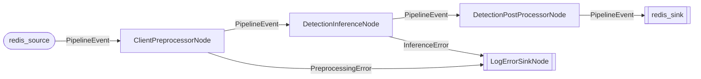

# triton-redis-connector

Граф-пайплайн для ML-инференса: читает данные из Redis Streams, обрабатывает, отправляет в NVIDIA Triton Inference Server, записывает результаты обратно в Redis.

## Основные возможности

- **6 параллельных вариантов исполнения** -- все узлы работают в выделенных потоках
- **Автоматическая маршрутизация** -- граф строится по типовым аннотациям `__orig_bases__`
- **PipelineEvent** -- типизированная композиция пользовательского контекста и стадии обработки
- **Конфигурация** -- Hydra YAML + Pydantic-валидация
- **ModelBundle** -- группировка процессоров для одной модели
- **Типизированная маршрутизация** -- `PipelineEvent` exact generic matching для мульти-модельных пайплайнов
- **Метрики** -- transit time, inference time, Triton-метрики, оконная агрегация
- **Debug-режим** -- `stop_on_error`
- **Mermaid-диаграмма** -- генерируется при старте для визуализации графа

## Варианты исполнения

Фреймворк предоставляет три примитива с параллельными вариантами исполнения (6 вариантов). Inline-вариантов нет -- все узлы работают в выделенных потоках.

### Source -- производит события

| Вариант | Базовый класс | `stop` |
|---------|----------|--------|
| `ThreadSource` | `BaseThreadSource[TOut]` | `threading.Event` |
| `ProcessSource` | `BaseProcessSource[TOut]` | `threading.Event` |

### Processor -- преобразует события

| Вариант | Базовый класс | `stop` |
|---------|----------|--------|
| `ThreadProcessor` | `BaseThreadProcessor[TIn, TOut]` | `threading.Event` |
| `ThreadPoolProcessor` | `BaseThreadPoolProcessor[TIn, TOut]` | `threading.Event` |
| `ProcessPoolProcessor` | `BaseProcessPoolProcessor[TIn, TOut]` | `threading.Event` |

### Sink -- потребляет события

| Вариант | Базовый класс | `stop` |
|---------|----------|--------|
| `ThreadSink` | `BaseThreadSink[TIn]` | `threading.Event` |

Все протоколы определены в `triton_redis_connector/protocols.py`. Обёртки для параллельных вариантов -- в `triton_redis_connector/engine/wrappers.py`.

### Базовые классы для пользовательских процессоров

Пользовательские процессоры наследуются от базовых классов, которые явно объявляют вариант исполнения:

```python
from triton_redis_connector import BaseThreadProcessor

class MyProcessor(BaseThreadProcessor[InputEvent, OutputEvent]):
    def __init__(self, param: str) -> None:
        super().__init__()
        self._param = param

    def __call__(self, event: InputEvent) -> OutputEvent | None:
        return process(event)

registry.register("proc", MyProcessor("value"))
```

### Доменная модель событий

- `Event` -- базовый класс с `fw: FrameworkMeta` (source_stream, message_id)
- `PipelineEvent[TCtx, TPayload]` -- типизированная композиция пользовательского контекста и payload обработки
- `ImagePayload` -- путь к изображению или байты для препроцессора
- `TritonRequest` -- тензор или байты для Triton-инференса
- `DetectionResult` / `ClassificationResult` -- типизированные результаты

### Построение пайплайна

#### Application.build() -- предпочтительный способ

```python
from triton_redis_connector import Application, ModelBundle, expand_bundle

bundle = ModelBundle(
    name="yolo",
    preprocessor=ClientPreprocessorNode[MyImageEvent](...),
    inference=DetectionInferenceNode(grpc_url="triton:8001"),
    postprocessor=DetectionPostProcessorNode[DetectionResult](det_postprocess),
    sink=LogErrorSinkNode(),
)

app = Application.build(
    config,
    processors=[source, *expand_bundle(bundle), redis_sink],
)
app.run()
```

Shipped-процессоры (ClientPreprocessorNode, DetectionInferenceNode, ClassificationInferenceNode, DetectionPostProcessorNode, ClassificationPostProcessorNode, LogErrorSinkNode) регистрируются через `Application.build()` или передаются явным списком.

## Построение графа

Граф строится автоматически по `__call__`-сигнатурам. `PipelineRegistry` инспектирует типовые аннотации каждого узла и создает ребра по совпадению типов:

```python
from triton_redis_connector.engine.registry import PipelineRegistry

registry = PipelineRegistry()
registry.register("source", MySource())         # __call__() -> EventA
registry.register("processor", MyProcessor())   # __call__(EventA) -> EventB
registry.register("sink", MySink())             # __call__(EventB) -> None
```

Union-типы в возвращаемом значении (`EventA | EventB | None`) создают ребра ко всем потребителям обоих типов.

## Диаграмма пайплайна

При старте `Application` автоматически генерирует Mermaid-диаграмму:



Форма узлов: `([Source])`, `[Processor]`, `[[Sink]]`.

## Конфигурация

Конфигурация загружается через Hydra и валидируется Pydantic-моделями (`triton_redis_connector/config/schema.py`):

```yaml
redis:
  host: ${oc.env:REDIS_HOST,redis}
  port: ${oc.env:REDIS_PORT,6379}
  db: 0

sources:
  - stream_name: input_images
    consumer_group: pipeline
    consumer_name: worker-1
    event_model: bytes
    batch_size: 10
    block_ms: 1000

sinks:
  - stream_name: detection_results
    maxlen: 10000

pipeline:
  model_name: yolo11s
  postprocessor:
    conf_threshold: 0.25
    iou_threshold: 0.45

inference:
  grpc_url: ${oc.env:TRITON_GRPC_URL,triton:8001}
  num_inference_workers: 2
  max_concurrent_per_worker: 8

preprocessing:
  decoder: opencv          # opencv | turbojpeg | dali
  decoder_pool_type: thread # thread | process
  decoder_pool_workers: 4
  default_target_size: [640, 640]

queues:
  maxsize: 1000

metrics:
  output_stream: metrics
  emit_interval_s: 5.0
  triton_poll_interval_s: 10.0
  stats_log_interval_s: 60.0
  transit_time_enabled: true

debug:
  stop_on_error: false
  single_thread: false

```

Переменные окружения подставляются через Hydra OmegaConf-resolver `${oc.env:VAR,default}`.

## Метрики и наблюдаемость

- **transit time** -- время прохождения события от `Source` до `Sink`
- **inference time** -- время инференса на Triton
- **stats logging** -- периодический вывод `processed/in_progress/errors` в лог
- **Triton collector** -- сбор метрик Triton (GPU utilization, queue times)
- **MetricBuffer + MetricEmitter** -- буферизация и запись метрик в Redis Stream
- **TimeWindowAggregator** -- оконная агрегация (RPS, latency percentiles)

## Debug-режим

```yaml
debug:
  stop_on_error: true    # остановить пайплайн при первой ошибке
  single_thread: true    # все узлы inline, один поток
```

## Точки расширения

1. **Новый Source/Processor/Sink** -- наследуйтесь от базового класса в `protocols.py`
2. **Новый декодер** -- реализуйте `ImageDecoder` протокол (`preprocessing/protocols.py`)
4. **Кастомные метрики** -- реализуйте `AggregationRuleProtocol`
5. **DI-провайдеры** -- добавьте Dishka-провайдер для своих зависимостей

## Структура модулей

```
triton_redis_connector/
  config/         -- Hydra + Pydantic конфигурация
  connectors/     -- Redis Stream I/O, consumer groups
  engine/         -- Application, PipelineRegistry, QueueBus, diagram
  errors/         -- типизированные ошибки (ConnectorError, InferenceError, ...)
  inference/      -- InferenceWorker, model registry
  metrics/        -- MetricBuffer, MetricEmitter, TritonCollector, агрегация
  preprocessing/  -- декодеры (OpenCV, TurboJPEG), letterbox
  protocols/      -- 6 параллельных вариантов, базовые классы, Envelope, фабрики
  providers/      -- Dishka DI-провайдеры (ConfigProvider, ConnectorProvider, InferenceProvider, MetricsProvider)
```

Подробная архитектура описана в [docs/architecture.md](../../docs/architecture.md).
